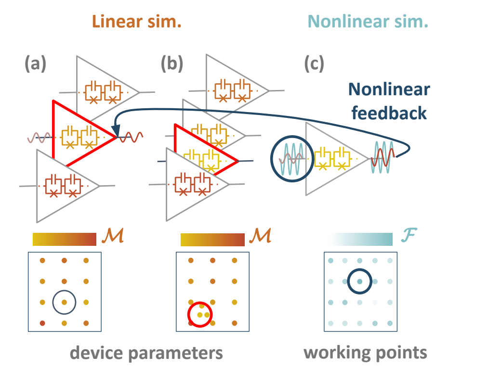
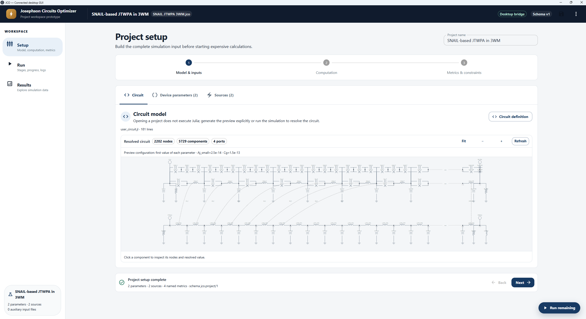
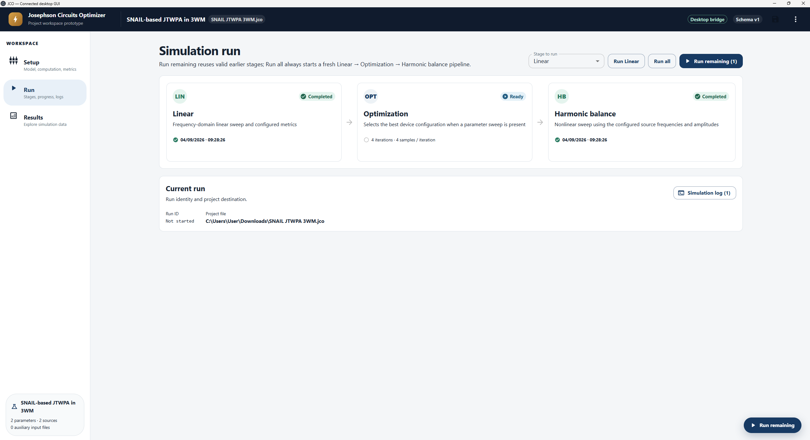
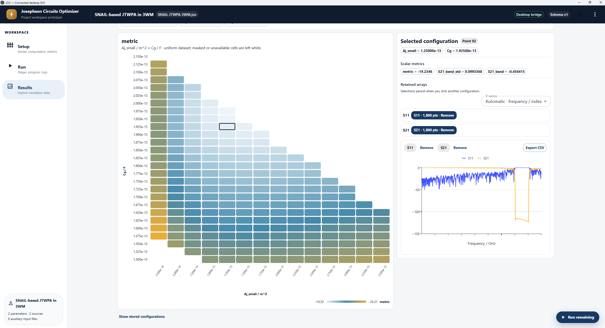

# JosephsonCircuitsOptimizer.jl (JCO)

**JosephsonCircuitsOptimizer.jl (JCO)** is a Julia framework for the automated exploration and optimization of superconducting Josephson circuits, built on [JosephsonCircuits.jl](https://josephsoncircuits.org/).

JCO combines three main stages:

1. **Linear exploration** of the device-parameter space;
2. **Surrogate-based optimization** of promising configurations;
3. **Nonlinear harmonic-balance analysis** of selected devices and working points.

Optional nonlinear feedback can use the pumped response to refine subsequent optimization cycles.

<p align="center">
  
</p>

JCO includes a desktop GUI and portable `.jco` project files for saving and sharing complete experiments.

## Documentation

See the **[JCO User Manual (PDF)](docs/JCO_Documentation.pdf)** for a detailed guide to the GUI, simulations, optimization, and project configuration.

## Quick Start

**Requirements:** Windows or Linux and a working Julia installation.

Download the latest desktop application from **[JCO-GUI Releases](https://github.com/SQE-INRiM/JosephsonCircuitsOptimizer/releases/latest)**.

### Windows

Download and run `JCO-GUI-<version>-Windows-Setup.exe` to install JCO, or use `JCO-GUI-<version>-Windows-Portable.exe` without installation.

<details>
<summary>⚠️ If Windows blocks installation or simulation</summary>

Windows may warn about the **unsigned JCO installer** (SmartScreen). Separately, Windows 11 **Smart App Control** may block native DLLs required by **Julia**, such as HDF5.

**This is a Windows–Julia compatibility issue, not a JCO bug.**

If you encounter blocked DLLs or error `0xc0e90002`, see [Microsoft's Smart App Control FAQ](https://support.microsoft.com/en-us/windows/smart-app-control-faq-285ea03d-fa88-4a37-8837-aacbe6d2e7d0).

As a workaround, you can disable Smart App Control under **Windows Security → App & browser control → Smart App Control settings**. However, doing so **reduces Windows security** and is not required for all users.

</details>

### Linux

Download `JCO-GUI-<version>-Linux-x64.AppImage`, then run:

```bash
chmod +x JCO-GUI-<version>-Linux-x64.AppImage
./JCO-GUI-<version>-Linux-x64.AppImage
```

Linux support is currently preliminary and limited to x86-64.

On first launch, JCO may need an internet connection to prepare its Julia environment. Use **Settings** to select your Julia executable and the number of threads.

## The `.jco` Project

A `.jco` file stores the circuit definition, simulation settings, custom Julia functions, and numerical results in one portable project.

Projects can be saved, shared, and reopened from the GUI. See the [User Manual](docs/JCO_Documentation.pdf) for details.

## Desktop GUI

### Setup

<p align="center">
  
</p>

<p align="center"><em>Define the circuit, parameters, and simulation settings.</em></p>

### Run

<p align="center">
  
</p>

<p align="center"><em>Run and monitor the simulation and optimization stages.</em></p>

### Results

<p align="center">
  
</p>

<p align="center"><em>Explore design spaces, optimization results, and nonlinear responses.</em></p>

## Citation

If you use JCO in scientific work, please cite:

> E. Palumbo *et al.*, **“JCO: Optimization Framework for Nonlinear Superconducting Circuits Using a Lumped-Element Approach and Harmonic Balance”**, *IEEE Transactions on Applied Superconductivity* (2026).  
> DOI: [10.1109/TASC.2026.3679488](https://doi.org/10.1109/TASC.2026.3679488)

Repository:

https://github.com/SQE-INRiM/JosephsonCircuitsOptimizer

## License

JosephsonCircuitsOptimizer.jl is released under the [MIT License](LICENSE.md).

<p align="center">
  
</p>

